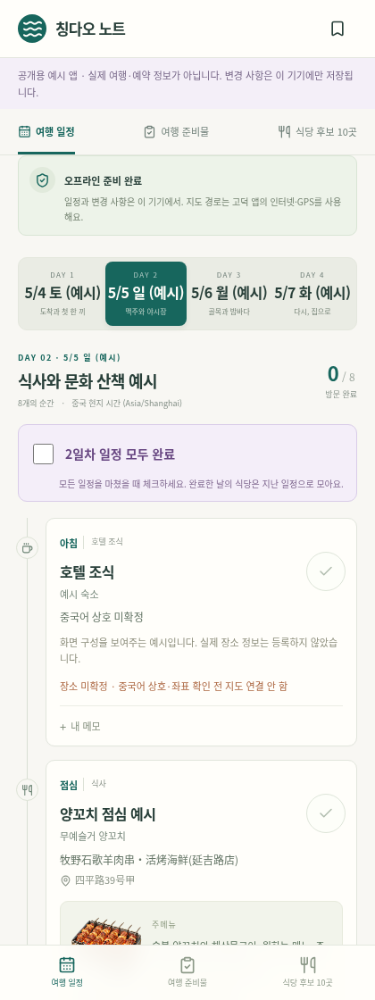
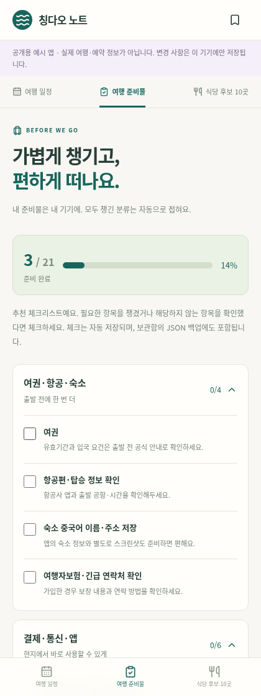
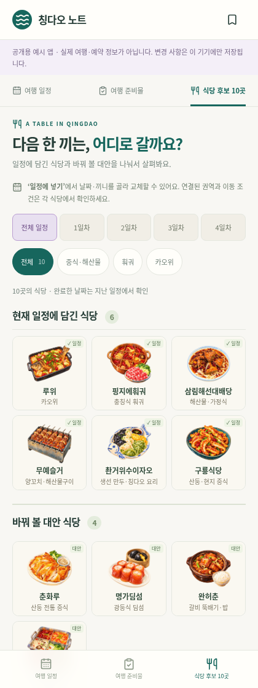

# 칭다오 여행 매니저

**인터넷 연결이 불안정한 여행지에서도 일정·준비물·식당 후보를 확인하고 관리하는 여행 웹앱입니다.**

여행 중 메모, 식당 대안 선택, 방문 완료 표시를 기기에 저장합니다. React · TypeScript · Vite로 만든 개인 프로젝트이며, 서버·회원가입·데이터베이스·API Key 없이 실행할 수 있습니다.

> 이 저장소의 날짜·숙소·항공 정보·일정 순서는 기능을 보여주기 위한 **공개용 예시**입니다. 실제 예약이나 개인 여행 계획을 포함하지 않습니다. 식당 정보는 참고 자료이며 최신 영업·메뉴를 보장하지 않습니다.

## 화면으로 보기

| 여행 일정 | 여행 준비물 | 식당 후보 |
| :---: | :---: | :---: |
|  |  |  |

공개용 예시 앱을 Chromium 모바일 크기로 촬영한 화면입니다. 음식 그림은 AI 생성 일러스트이며 실제 음식 사진이 아닙니다.

## PWA가 뭔가요?

**웹사이트를 휴대폰 홈 화면에 추가해 앱처럼 사용할 수 있는 방식**입니다. PWA는 *Progressive Web App*의 줄임말입니다.

이 프로젝트는 필요한 화면·이미지를 미리 저장하고 사용자의 변경 사항도 기기에 보관하도록 구현했습니다. 그래서 처음 준비를 마치면 인터넷 없이도 일정을 확인하고 수정할 수 있습니다. PWA라는 이름만으로 모든 웹사이트가 오프라인을 지원하는 것은 아닙니다.

- **홈 화면 설치:** App Store를 거치지 않고 브라우저에서 추가합니다.
- **오프라인 사용:** ‘오프라인 준비 완료’를 확인한 기기에서 이용합니다.
- **업데이트:** 새 버전 안내가 나오면 적용할 수 있습니다.
- **지도:** 고덕지도 검색·경로 탐색에는 별도의 인터넷과 앱의 위치 권한이 필요합니다.

## iPhone 홈 화면에 추가하기

배포된 HTTPS 웹앱을 **Safari**에서 연 다음 진행하세요. 이 저장소에는 개인용 배포 주소를 공개하지 않습니다.

1. Safari의 **공유 버튼**을 누릅니다.
2. 메뉴에서 **홈 화면에 추가**를 선택합니다. 목록에 보이지 않으면 메뉴를 더 내려 확인합니다.
3. 이름을 확인하고 **추가**를 누릅니다.
4. 홈 화면 아이콘으로 앱을 열고 **오프라인 준비 완료**가 나올 때까지 기다립니다.
5. 비행기 모드에서 앱을 종료했다가 다시 열어 일정과 저장한 메모를 확인합니다.

JSON 파일 다운로드는 평소 사용에 필요하지 않습니다. 기기 변경이나 사이트 데이터 삭제에 대비해 백업하고 싶을 때 사용하세요. [사용·백업·설치 상세 안내](docs/getting-started.md)

## 할 수 있는 일

| 기능 | 동작 |
|---|---|
| 여행 일정 | 날짜별 조회, 메모, 개별 방문 완료, 완료 카드 접기 |
| 하루 완료 | 보라색 ‘N일차 일정 모두 완료’, 해당 날짜 전체 완료·해제 |
| 식당 교체 | 연결된 끼니의 식당·설명·이미지·지도 검색 대상 함께 변경 |
| 모바일 식당 앨범 | 정사각형 3열, 탭해서 상세 보기, 날짜·음식 종류 필터 |
| 지난 일정 | 하루를 모두 마치면 식당·대안을 접힌 영역으로 분류 |
| 준비물 | 분류별 체크, 모두 준비한 분류 자동 접기 |
| 데이터 보관 | 기기 내 자동 저장, JSON 백업·검증 후 복원 |
| 오프라인 | 앱 화면·예시 일정·음식 그림 캐시, 저장 상태 유지 |

**현재는 정해진 예시 일정 안에서 사용하는 앱입니다.** 식당 직접 추가, 일정 추가·삭제·순서 변경, 숙소 자유 편집, 동행자 자동 동기화는 아직 지원하지 않습니다. [현재 범위와 확장 계획](docs/roadmap.md)

## 개발 환경에서 실행하기

Node.js **24 LTS**와 npm을 사용합니다. 비밀키나 별도 서비스가 필요하지 않습니다.

```sh
git clone https://github.com/jaewoo2/qingdao-trip-manager.git
cd qingdao-trip-manager
npm ci
npm run dev
```

터미널에 표시되는 개발 서버 주소로 접속합니다. **오프라인 기능은 개발 서버가 아닌 빌드 결과에서 시험**합니다.

```sh
npm run build
npm run preview
```

```sh
npm run lint
npm run typecheck
npm test
npm run test:e2e
npm run check:public
```

브라우저 테스트 전 시스템 Chromium이 없다면 `npx playwright install chromium`을 실행하세요. `PLAYWRIGHT_CHROMIUM_EXECUTABLE_PATH`로 실행 파일을 지정할 수도 있습니다.

## 어떻게 만들었나요?

- [개발 배경과 개선 과정](docs/development.md): 여행 중 필요한 기능부터 모바일 앨범까지
- [구조와 오프라인 동작](docs/architecture.md): 무엇을 어디에 저장하는지
- [검증 결과와 한계](docs/verification.md): 자동 테스트와 사용자 iPhone 확인 구분
- [예시 데이터 바꾸기·배포하기](docs/customization.md): 현재 가능한 수정 범위
- [이미지 출처](docs/asset-sources.md)

## 데이터와 라이선스

변경 사항은 **기기·브라우저·사이트 주소별**로 보관되며 다른 사람과 자동 공유되지 않습니다. 브라우저 데이터 삭제나 저장 공간 정리로 지워질 수 있습니다. 앱에 입력한 메모는 서버로 전송하지 않지만 지도·외부 출처 링크를 누르면 해당 서비스에 접속합니다.

코드와 문서는 [MIT License](LICENSE)로 공개합니다. 음식 일러스트는 MIT 적용 대상에서 제외하며 [별도 안내](public/restaurant-illustrations/README.md)를 따릅니다. 외부 의존성은 각 라이선스를 따릅니다.
